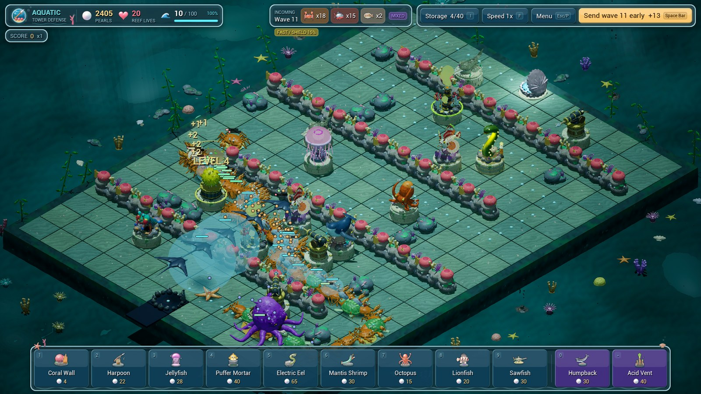
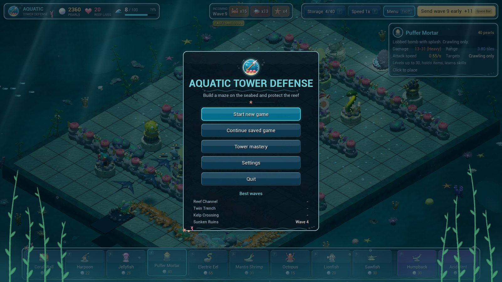
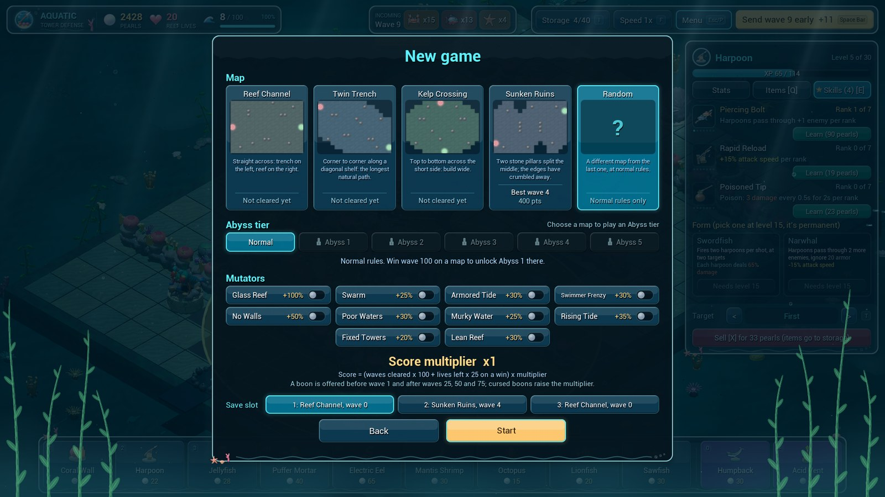
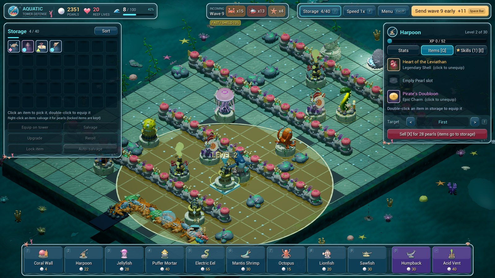
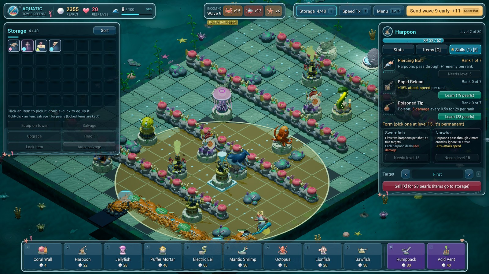
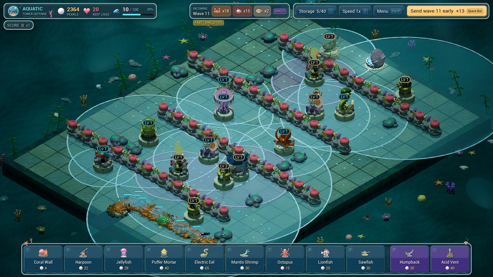
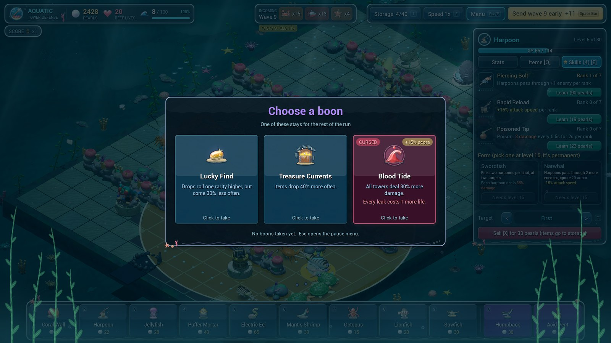
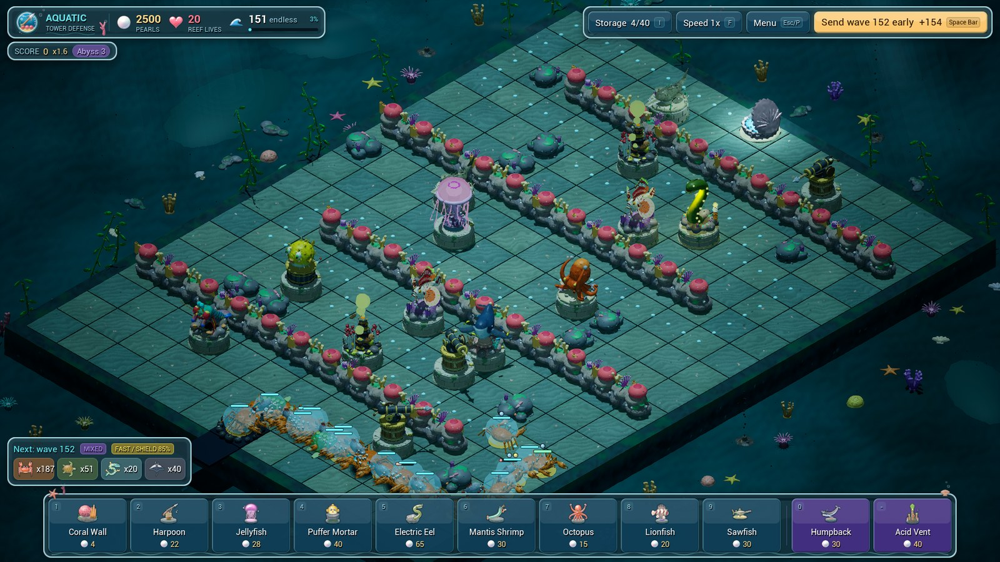
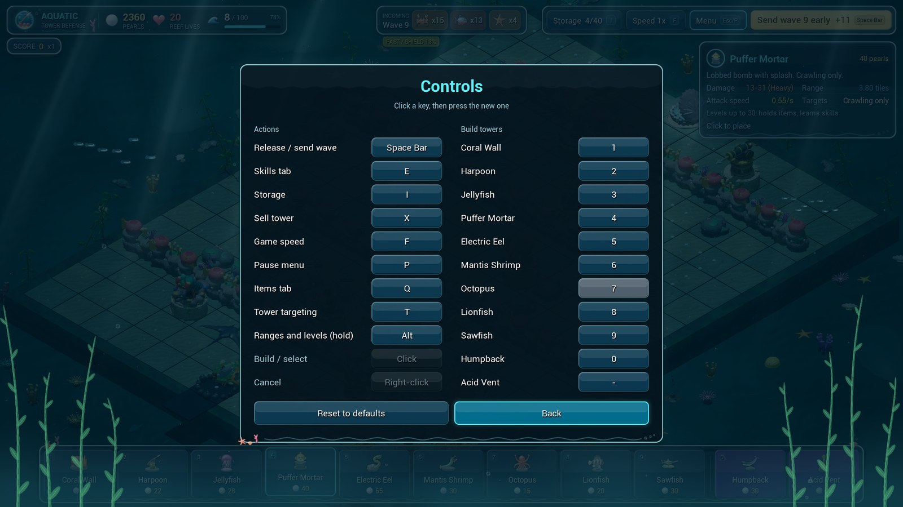

# Aquatic Tower Defense

A maze-building tower defense game set on the seabed, written in C++ on Unreal Engine 5.8 (built with AI assistance). Wall off a path and line it with sea-creature towers to stop creatures reaching your reef. Survive 100 waves, then keep going in Endless mode.



## Features

- 11 towers that level up, learn skills, hold items and pick one of two forms at level 15
- 8 creature types, with elite mini-bosses and a Kraken boss every 10th wave
- Item drops (Shell, Pearl, Charm) in four rarities, plus unique legendaries
- 4 maps, Abyss difficulty tiers, mutators, boons and Endless mode
- Tower mastery, three save slots and rebindable keys
- Procedural models, icons painted in code and synthesized sounds

## Screenshots

| | |
|---|---|
|  |  |
|  |  |
|  |  |
|  |  |

## Towers

| Key | Tower | Cost | Role |
|---|---|---|---|
| 1 | Coral Wall | 4 | Blocks a tile to shape the maze |
| 2 | Harpoon | 22 | Long range, hits swimmers |
| 3 | Jellyfish | 28 | Area pulse that slows |
| 4 | Puffer Mortar | 40 | Splash, crawlers only |
| 5 | Electric Eel | 65 | Chain lightning that ignores armor |
| 6 | Mantis Shrimp | 30 | Short-range heavy punch that stuns |
| 7 | Octopus | 15 | Very fast, light damage |
| 8 | Lionfish | 20 | Poison |
| 9 | Sawfish | 30 | Bleed |
| 0 | Humpback | 30 | Aura: faster attacks for nearby towers |
| - | Acid Vent | 40 | Aura: lowers creature armor |

## Creatures

Crab, Piranha (fast), Sea Turtle (armored), Manta (swims over walls), Sea Star (splits), Cuttlefish (armor aura), Shock Eel (weakens towers) and the Kraken boss.

## Controls

| Action | Key |
|---|---|
| Build / select, cancel | Left click, right click |
| Build tower | 1-9, 0, - |
| Send next wave | Space |
| Show ranges (hold) | Alt |
| Items, skills, storage | Q, E, I |
| Sell, targeting, speed | X, T, F |
| Pause | P / Esc |
| Pan, zoom | WASD / screen edge, mouse wheel |

You can rebind keys in Settings > Controls.

## Building

Requires Windows, **Unreal Engine 5.8** and Visual Studio 2022 with C++ game development.

1. Open `AquaticTowerDefense.uproject` (or generate the project files and build **Development Editor / Win64**).
2. Press Play.

Command-line build:

```powershell
& "C:\Program Files\Epic Games\UE_5.8\Engine\Build\BatchFiles\Build.bat" AquaticTowerDefenseEditor Win64 Development -Project="$PWD\AquaticTowerDefense.uproject" -WaitMutex
```

Tests:

```powershell
& "C:\Program Files\Epic Games\UE_5.8\Engine\Binaries\Win64\UnrealEditor-Cmd.exe" "$PWD\AquaticTowerDefense.uproject" -ExecCmds="Automation RunTests ATD; Quit" -nullrhi -unattended
```

## Project structure

```
Config/                      Engine, game and input settings
Content/ATDModels/           Procedural model data
Content/AquaticTowerDefense/ Level, materials, audio
Source/AquaticTowerDefense/TowerDefense/
  TDGameMode, TDGrid         Run flow, board and pathfinding
  TDTower, TDEnemy           Towers and creatures
  TDItems, TDRun             Items, skills, boons, mutators, Abyss tiers
  TDHUD*, TDIcons*           Canvas HUD and code-painted icons
  TDModel*, TDAudio          Mesh building and sound
  TDDevTools, Tests/         Dev commands and automation tests
Tools/                       Sound and model tools
docs/screenshots/            README images
```
